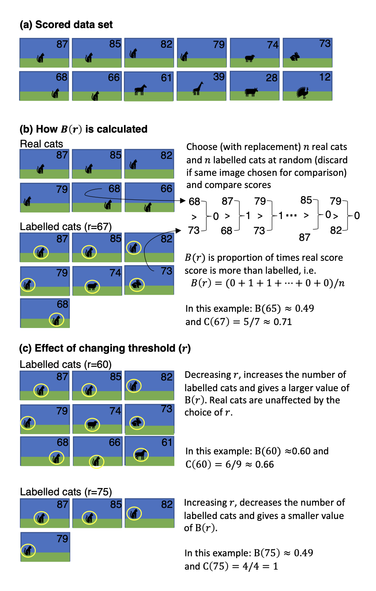

# Precision at the indistinguishability threshold

This repository contains the code and article for *Precision at the indistinguishability threshold: a method for evaluating classification algorithms* by David J. T. Sumpter ([arXiv:2311.11422](https://arxiv.org/abs/2311.11422)).

A good performance metric can be stated in words. The area under the ROC curve (AUC) is the probability that a randomly chosen image of a cat scores higher than a randomly chosen image without one. But this is rarely the question we face in practice, and adding images that are easy to reject pushes it towards one. I propose a metric that answers the question we usually want answered: when the algorithm is tuned so that it can no longer distinguish the images it labels as cats from the images that really contain cats, how often does an image labelled as a cat actually contain one? To construct it, the decision threshold is first set so that a randomly chosen labelled image and a randomly chosen real cat are equally likely to have the higher score. The metric is then the precision at this threshold, which I call *precision at the indistinguishability threshold*. Unlike AUC, it is unaffected by adding easy cases and, unlike the F1-score, its value can be explained directly in words. I derive exact relationships with precision, recall and F1, showing that at this threshold more images are always labelled as cats than there are cats, so that recall exceeds precision, and that the threshold generally differs from the one that maximises F1. On a benchmark data set of mammograms, two classifiers with the same AUC differ by 13 percentage points in precision at the indistinguishability threshold.

## Code

`simple_example.py` is the example from figure 1.

`ABC.py` creates the rest of the figures in the article and saves them to `Article/Figures/`. It also prints the values of $C(r_b)$ quoted in the text. Set `include_other_curves=True` to produce `Bplot2.pdf` (figure 6) instead of `Bplot.pdf`. It requires `numpy`, `scikit-learn` and `matplotlib`.

`benchmarks.py` produces the results in the section *Two benchmark data sets* (table 1): logistic regression and gradient boosting on the Adult and Mammography data sets, downloaded from OpenML on first run. It also requires `pandas`.

## Article

The LaTeX source, bibliography and figures are in `Article/`, along with the compiled article, [`Article/ABC.pdf`](Article/ABC.pdf). `Article.zip` contains the source files.

### Changes since the arXiv version (v1, November 2023)

The section *Relationship to F1 score* (previously *Similarity to F1 score*) replaces the earlier informal comparison with exact results. $B(r)$ decomposes into precision, recall and an AUC computed on the labelled members only. At the indistinguishability threshold, FN/FP equals $(2\alpha-1)C$. As a result, $r_b$ always lies below the precision–recall break-even point, and recall and F1 at $r_b$ follow from precision and $\alpha$. The section also shows why the F1-maximising threshold coincides with $r_b$ only in special cases.

A new section, *Two benchmark data sets*, applies the measure to two benchmark data sets. On the Mammography data, the two classifiers have the same AUC, but precision at the indistinguishability threshold is 0.13 higher for gradient boosting (95% CI 0.06 to 0.21).

The derivation of $B(r)$ in terms of the true and false positive rates has moved to an appendix.

The version here also corrects the following errors in the arXiv version.

- **Figures.** `ABC.py` used the wrong data set when computing $B(r)$ for six of the nine panels (it indexed the data with `cj*3+cj` instead of `cj*3+ci`). This moved $r_b$ in figures 2, 4, 5 and 6, most visibly in panels (g) and (h). The figures have been regenerated, and the values quoted in the text updated accordingly ($C(r_b) \approx 0.87$, $0.70$ and $0.53$ for the three columns of data sets).
- **Figure 1.** The worked example gave $B(65) \approx 0.49$ and $B(75) \approx 0.49$. With the scores shown, $B(67) = 18/37 \approx 0.49$ and $B(75) = 6/20 = 0.30$. Also, "real score score" is now "real score".
- **Equations** (numbered as in the arXiv version). The denominators in equations (10), (15), (18) and (19) should be $P v(r) + N u(r)$; the integrand in equations (14), (15) and (19) should be $f_N(t) v(t)$; and the integrals in equations (11) and (12) had incorrect limits or variables. The code always used the correct expressions.
- **Text.** The number of 'easy' data points per panel was listed in the wrong order; the description of what happens at large and small thresholds had "former" and "latter" swapped; and the logistic function should be $1/(1+\exp(-r))$. A number of smaller typos have also been fixed.
